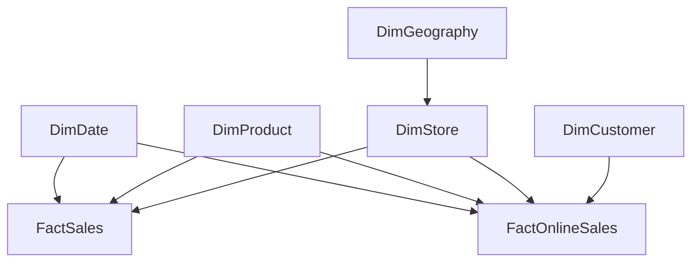

# Dashboard and data-model tour

This is a **visual guide to the recovered report structure**, not a live Power BI dashboard or an independently validated analytical result. The original PBIX and source dataset are not distributed.

## The three existing report pages

| Page | What a reviewer can learn | Important caveat |
| --- | --- | --- |
| **Sales Performance** | Sales by product and brand, month-of-year comparisons, and store-continent performance | The original monthly visual is sorted by sales value rather than chronology; its order should not be interpreted as a time trend |
| **Online Customers Analysis** | Online sales, purchasing-customer counts, age groups, and a top-customer ranking | The report's “Avg Customer LTV” is sales per purchasing customer under current filters, not a lifetime value model |
| **Geographic Performance** | Sales and represented stores by the geography of the **store** | These are not customer-residence maps; some chart titles and denominator definitions require review |

No report screenshots are shown because the available screenshots contain customer identifiers. This guide intentionally contains no customer records.

## Semantic model, as recovered from metadata



The diagram shows **eight active, single-direction, many-to-one relationships**. Arrows indicate dimension-to-fact filter direction, not the physical direction of imported data. Power BI also contains auto date artifacts that are excluded from this simplified view. See the [full relationship and measure inventory](model-and-measures.md).

## DAX examples from the existing model

These three definitions describe *existing* calculations, not newly tested results:

```dax
Total Sales = SUM(FactSales[SalesAmount])

Online Sales = SUM(FactOnlineSales[SalesAmount])

Total Online Customers = DISTINCTCOUNT(FactOnlineSales[CustomerKey])
```

**Interpretation matters.** `Total Online Customers` counts distinct customer keys represented in online fact rows under the current filter context. `DISTINCTCOUNT` includes a blank key if one exists. Neither the fact grain nor source revenue reconciliation has been independently validated.

Additional proposals live under [examples](../examples/); those files are **not implemented or Power BI engine-tested**.

## How to explore this repository

- [README](../README.md): 30-second overview and project status
- [Model and measures](model-and-measures.md): relationships and 19 existing DAX measures
- [Known limitations](known-limitations.md): issues observed in existing report definitions
- [Validation plan](validation-plan.md): specific checks required before interpreting dashboard figures as verified

### Reproduction status

The repository is a **documented portfolio case study**, not a runnable dashboard. The original PBIX, imported source CSVs, and screenshots are intentionally excluded. A usable data-free Power BI template would require authorized export and validation using Power BI Desktop on Windows.
