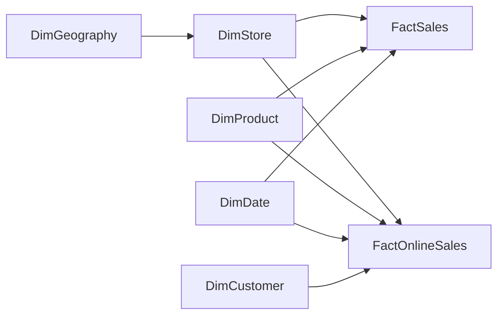

# Contoso retail analytics — Power BI case study

Retail analysts and business stakeholders need to compare product sales, understand online customer segments, and investigate geographic performance. This university project organizes those questions into a Power BI dashboard using instructor-provided Contoso data; its recommendations remain hypotheses, not measured business outcomes.

## Existing dashboard

This project includes three report pages: **Sales Performance**, **Online Customers Analysis**, and **Geographic Performance**, with cards, charts, and slicers. Recovered metadata documents **seven report tables, eight active single-direction relationships, and 19 DAX measures**. These definitions are metadata-extracted, not engine-validated; the counts exclude automatic date artifacts.

| Analytical question | Techniques evidenced in the existing work |
|---|---|
| Which brands and product classes contribute to sales? | Product comparisons; DAX `SUM` for sales and quantity, `COUNTROWS` for fact-row counts, and `DIVIDE` for ratios. |
| How do online customer segments contribute to revenue? | Power Query age-group preparation; DAX `DISTINCTCOUNT` for purchasing customers and `ALL` for age-group share denominators. |
| How does sales performance vary by geography and store? | Store-linked geography filtering; sales per represented store key using sales and distinct represented store-key counts. |

Power Query preparation also includes column removal, data-type conversion, and replacement of empty-string geography labels. These are evidenced transformations, not a claim that data quality has been validated.

## Semantic model

Arrows show filter direction from the one side to the many side. Geography filters both facts through stores; customers filter only online sales. No relationship joins the two facts directly.

## Proposed fixes — not implemented

The existing report still sorts its month chart by sales value and labels revenue per purchasing customer as “Avg Customer LTV.” Proposed changes are chronological month sorting, an explicit Unknown product group, clearer measure names, duplicate-measure consolidation, and consistent percentage scales. Fact-row grain and overlap between the facts must be established before interpreting order averages or online sales share. Proposed code examples have not been run or compiled.

## Data and validation limitations

**No PBIX or data is distributed. Screenshot figures have not been independently reconciled, and no Power BI execution tests have been performed.** The supplied package cannot refresh or reproduce the analysis; dataset redistribution rights and contributor attribution remain unresolved. No business uplift or validated KPI results are claimed.

Dashboard screenshots are omitted to avoid exposing customer identifiers.

Further detail: [model and measures](model-and-measures.md), [known limitations](known-limitations.md), and [validation plan](validation-plan.md).
